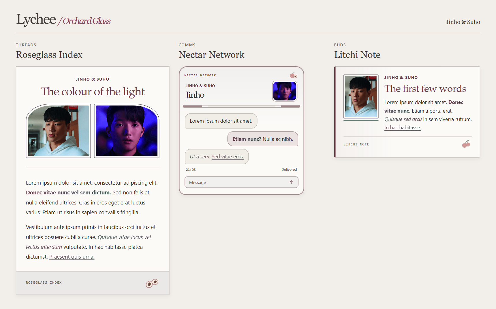

# Lychee · Orchard Glass

Fifteen JCink templates for Jinho & Suho.

**[Open the template editor](https://raw.githack.com/lexdoescodingnow/templates/main/lychee/lychee-collection-preview.html)** · [Download the editor](https://github.com/lexdoescodingnow/templates/raw/refs/heads/main/lychee/lychee-collection-preview.html) · [Forum masterpost](../forum-posts/lychee-forum-masterpost.txt)

Choose a design to preview it in your member colours. **Copy template** keeps the editable fields. The named copy uses the character names and title shown in the preview. Paste the entire block into a JCink post with HTML enabled. Both dohtml tags are already included.

| Threads | Comms | Buds |
| --- | --- | --- |
| [Lychee Lithograph](lychee-lychee-lithograph-thread-01.txt) | [Lychee Line](lychee-lychee-line-comms-01.txt) | [Litchi Note](lychee-litchi-note-bud-01.txt) |
| [Roseglass Index](lychee-roseglass-index-thread-02.txt) | [Glasshouse Ping](lychee-glasshouse-ping-comms-02.txt) | [Pitstop](lychee-pitstop-bud-02.txt) |
| [Orchard Receipt](lychee-orchard-receipt-thread-03.txt) | [Peel Dial](lychee-peel-dial-comms-03.txt) | [Shell Slip](lychee-shell-slip-bud-03.txt) |
| [Pale Lantern](lychee-pale-lantern-thread-04.txt) | [Nectar Network](lychee-nectar-network-comms-04.txt) | [Bloom Byte](lychee-bloom-byte-bud-04.txt) |
| [Twin-Pit Almanac](lychee-twin-pit-almanac-thread-05.txt) | [Two Seed Signal](lychee-two-seed-signal-comms-05.txt) | [Soft Kernel](lychee-soft-kernel-bud-05.txt) |

The name, link, title, portraits and writing sit at the top of each snippet. Use a paragraph for each message. In the editor, bold, italic and underline BBCode convert to HTML when you copy. For direct HTML edits, use `<b>`, `<i>` and `<u>`. Bold and underline follow the three member colours in order. Italics reverse the gradient.

The forum chooses the light or dark palette. Portraits can be swapped, added or removed in the editor. The previously published templates also receive layout fixes through their existing stylesheet address.

To rebuild the posting files, stylesheets, editor and forum masterpost, run `node lychee/build.cjs` from the repository root.
